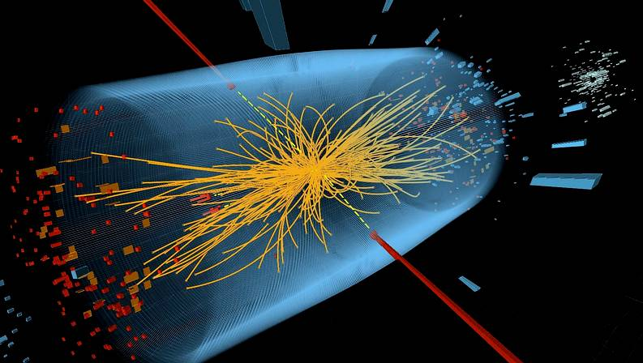
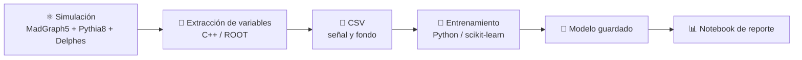

# HiggsClassifierML


### Encontrando al bosón de Higgs entre un mar de fotones, con inteligencia artificial

Un proyecto de principio a fin: **simulo colisiones de protones**, extraigo la información que dejan los detectores y entreno un modelo de *machine learning* que aprende a decidir, evento por evento, si lo que se ve es una **señal del bosón de Higgs** o simplemente **ruido de fondo**.

Todo el flujo está automatizado: desde la simulación de las colisiones hasta un reporte final con los resultados.

---

## ❓ ¿Qué problema resuelve?

En 2012 se descubrió el bosón de Higgs en el LHC. Una de las formas más limpias de verlo es cuando se desintegra en **dos fotones** (partículas de luz). El problema: existen muchos otros procesos que también producen dos fotones y que, a simple vista, **se ven casi idénticos**. Es como buscar una aguja en un pajar... donde el pajar también tiene forma de aguja.

Este proyecto ataca ese problema en dos pasos:

1. **Simular** miles de colisiones: unas donde un Higgs se convierte en dos fotones (*señal*) y otras donde dos fotones aparecen por otras causas (*fondo*).
2. **Entrenar un modelo** que mire las características de cada evento (energías, ángulos, masa del par de fotones, etc.) y aprenda a distinguirlos.



---

## ⚙️ Cómo funciona



| Etapa | Qué hace | Herramientas |
|---|---|---|
| **Simulación** | Genera colisiones protón-protón de señal (`pp → H → γγ`) y de fondo (`pp → γγ`), simula la lluvia de partículas y la respuesta del detector. | MadGraph5, Pythia8, Delphes |
| **Extracción** | Lee los archivos del detector y calcula 13 variables físicas por evento, guardándolas en un CSV. | C++, ROOT |
| **Entrenamiento** | Enseña a un modelo a separar señal de fondo usando el 80 % de los eventos (con ambas clases balanceadas) y reserva el 20 % restante para evaluarlo. | Python, scikit-learn |
| **Reporte** | Mide qué tan bien funciona el modelo con eventos que **nunca vio**, y estima su utilidad para un análisis real. | Jupyter, pandas, matplotlib |

---

## 📁 Estructura del proyecto

```
HiggsClassifierML/
├── simulation/                  # Simulaciones de MadGraph (se genera al correr el script)
│   └── run_simulations.sh       # Genera señal y fondo de forma automática
├── src/
│   ├── data_preprocessing.cpp   # ROOT → CSV con las variables de cada evento
│   ├── train_classifier.py      # Entrena y guarda el modelo
├── data/
|   └── signal_vars.csv          # CSV con las variables de la simulación de higgs
|   └── bkg_vars.csv             # CSV con las variables de la simulación de ruido de fondo
├── model/
|   └── classifier_model.joblib  # Modelo entrenado
└── results/
    └── model_report.ipynb       # Reporte de resultados
```

---

## 📋 Variables que usa el modelo

Para cada evento se extraen las propiedades de los **dos fotones más energéticos** y del evento completo:

| Grupo | Variables |
|---|---|
| Fotón principal | `photon1_pt`, `photon1_eta`, `photon1_phi` |
| Segundo fotón | `photon2_pt`, `photon2_eta`, `photon2_phi` |
| Sistema de dos fotones | `m_gg` (masa conjunta), `diphoton_pt`, `diphoton_eta`, `delta_r_gg` (separación angular) |
| Evento completo | `n_photons`, `n_jets`, `missing_et` |
| Peso | `event_weight` (guardado para análisis posteriores) |

Los eventos con menos de dos fotones **no se descartan**: las variables que no se pueden calcular quedan marcadas y el modelo aprende a manejarlas.

---

## 📈 Resultados

Con **10 000 eventos de señal y 10 000 de fondo** (80 % para entrenar, 20 % reservado para evaluar):

| Medida | Resultado |
|---|---|
| Acierto global en eventos nunca vistos | **97 %** |
| Capacidad de separar señal de fondo (AUC) | **0.995** (1.0 sería perfecto) |
| Aciertos de señal / de fondo | **96 % / 97 %** |
| Señales de overfitting (el modelo memoriza en vez de aprender) | **Ninguna**: rinde casi igual con datos conocidos y desconocidos |

Cuando el evento tiene dos o más fotones, la capacidad de separación sube a **0.999**.

El reporte también incluye curva ROC, distribución de las puntuaciones del modelo, las variables que más pesan en la decisión y una estimación de la significancia estadística según el corte que se elija.

<!-- Para sumar impacto visual: exporta tus gráficas del notebook a una carpeta docs/ y descomenta:


-->

---

## 🚀 Cómo ejecutarlo

### Requisitos
- [MadGraph5_aMC@NLO](https://launchpad.net/mg5amcnlo) con Pythia8 y Delphes instalados
- [CERN ROOT](https://root.cern/) y un compilador de C++17
- Python 3.9+ con `numpy pandas scikit-learn joblib matplotlib scipy`

### Paso a paso

**1. Simular señal y fondo** (se puede elegir el número de eventos; por defecto 10 000)
```bash
cd simulation
./run_simulations.sh 10000
```

**2. Extraer las variables a CSV**
```bash
cd ../src
g++ -O2 -std=c++17 data_preprocessing.cpp -o data_preprocessing $(root-config --cflags --libs)

./data_preprocessing ../simulation/signal_pp_H_aa/Events/run_01/tag_1_delphes_events.root ../data/signal_vars.csv
./data_preprocessing ../simulation/bkg_pp_aa/Events/run_01/tag_1_delphes_events.root ../data/bkg_vars.csv
```

**3. Entrenar el modelo**
```bash
python train_classifier.py ../data/signal_vars.csv ../data/bkg_vars.csv
```
El modelo queda guardado en `model/`. Con `--drop m_gg` se puede probar qué tan bien funciona *sin* la masa del par de fotones por ejemplo.

**4. Ver el reporte**
```bash
jupyter notebook model_report.ipynb
```

---

## 🧠 Lo que muestra este proyecto

- **Física de altas energías aplicada**: simulación completa de colisiones y detector con las herramientas estándar de la comunidad.
- **Programación en C++ con ROOT** para procesar datos de física de partículas.
- **Machine learning con criterio**: separación de datos para evaluar de forma honesta, balance entre clases y comprobaciones de overfitting.
- **Automatización y reproducibilidad**: un script lanza las simulaciones, verifica que salieron bien y el entrenamiento guarda la semilla y las versiones usadas para poder repetir los resultados.
- **Comunicación de resultados**: un notebook que traduce las métricas en algo que se puede entender y discutir.

---

## 🔭 Próximos pasos

Este es un estudio con simulaciones simplificadas; hay varias formas naturales de acercarlo a un análisis real:

- Usar **cortes de generación idénticos** en señal y fondo, para que el modelo aprenda física y no diferencias de cómo se generaron las muestras.
- Añadir **otros fondos** realistas (por ejemplo, un fotón acompañado de un jet que se confunde con otro fotón).
- Incorporar **incertidumbres sistemáticas** en la estimación de significancia.
- Probar otros modelos y comparar su desempeño, o exportar el modelo a **ONNX** para usarlo directamente desde C++/ROOT.

---

## 🛠️ Tecnologías

`C++` · `CERN ROOT` · `MadGraph5` · `Pythia8` · `Delphes` · `Python` · `scikit-learn` · `pandas` · `Jupyter` · `Bash`

---

## 👤 Autor

**Vicente Bravo Millar - Ingeniero Físico / Licenciado en Física Aplicada** · [LinkedIn](https://www.linkedin.com/in/vicente-ignacio-millar-bravo-11919221a) · [GitHub](https://vicentemillar1003.github.io/)
